<a href="https://nagabhavit.github.io/">
  
</a>

<p align="center">
  
  
  
  
</p>

<p align="center">
  <a href="https://nagabhavit.github.io/"></a>
  <a href="https://www.linkedin.com/in/nagabhavit-pampati-b3b430266/"></a>
  <a href="mailto:nagabhavit.p@gmail.com"></a>
</p>

<br/>

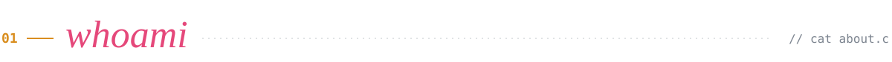

```c
/*
 * whoami.c: data-science undergrad, compiled in Hyderabad, linked in Bengaluru
 *
 * $Id: whoami.c,v 4.2 2026/10/14 nagabhavit Exp $
 *
 * SYNOPSIS
 *     B.Tech CSE (Data Science), Manipal Institute of Technology, class of '27
 *
 * DESCRIPTION
 *     I like problems where the data is big, messy, or alive: streaming parsers
 *     that chew through multi-gigabyte biomedical dumps, models that have to answer
 *     a payment in under 100 ms, and clusters I break on purpose to watch them heal.
 *
 *     Most recently I built an AI drug-discovery pipeline at SCIINV Biosciences:
 *     molecule generators, biomedical knowledge graphs, docking runs, ADMET filters.
 *
 * CURRENTLY
 *     building    FraudGuard: Kafka + Redis + LightGBM fraud scoring, p99 <= 100 ms
 *     breaking    Kubernetes, deliberately, with Locust pointed at it
 *     reading     whatever the punch card at the bottom of this page says
 *
 * BUGS
 *     Will rewrite your parser to stream if the input is over 1 GB.
 *     Believes Leclerc wins the title next season. Every season.
 */

main() { printf("hello, world\n"); }    /* K&R, 1978. still the right first line */
```

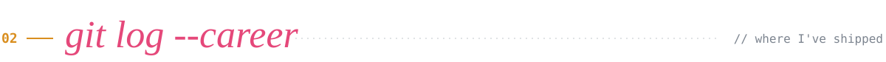

```diff
$ git log --patch career

commit 4f2a9c1 (HEAD -> career)
@@ May – Jul 2026 · Hyderabad @@ AI Engineering Intern, SCIINV Biosciences × Innominds
+ end-to-end computational drug-discovery pipeline: molecular generators -> BioKG, MeSH -> EFO
+ streaming lxml + Pydantic v2 ingestion of multi-GB DrugBank & PubChem dumps, memory-capped
- loading a 4 GB XML file into RAM and hoping for the best
+ AutoDock Vina docking + an ADMET schema to vet AI-generated drug candidates
+ CI on GitHub Actions with strict mypy + ruff gates; the suite stays at 100% passing

commit 9b07e3d
@@ Dec 2025 · Hyderabad @@ Software Development Intern, GSPANN Technologies
+ responsive React registration app built on a component architecture
+ state management and form validation for fast, clean user-data handling

commit 2d61f08
@@ May – Jul 2025 · Hyderabad @@ Web Development Intern, V4Infotech
+ full-stack Flask app that aggregates and searches courses across platforms
+ multithreaded scraping with BeautifulSoup + Selenium, advanced filters, CSV export
- copy-pasting course listings into a spreadsheet by hand

commit 0000001 (tag: init)
@@ 2023 – 2027 · Bengaluru @@ B.Tech CSE (Data Science), Manipal Institute of Technology
+ data structures, algorithms, OOP, DBMS, and an unreasonable number of Jupyter tabs
```

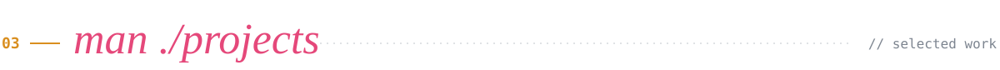

<p align="center">
  <a href="https://github.com/nagabhavit/FraudGuard">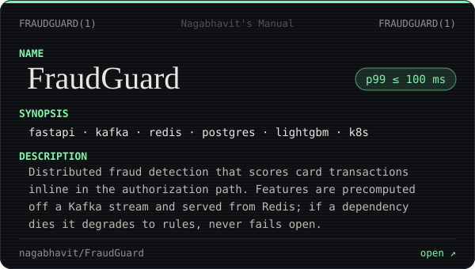</a>
  <a href="https://github.com/nagabhavit/kubernetes-chaos-engineering">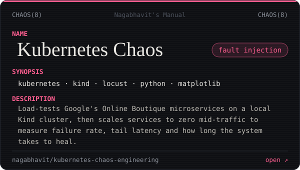</a>
  <a href="https://nagabhavit.github.io/">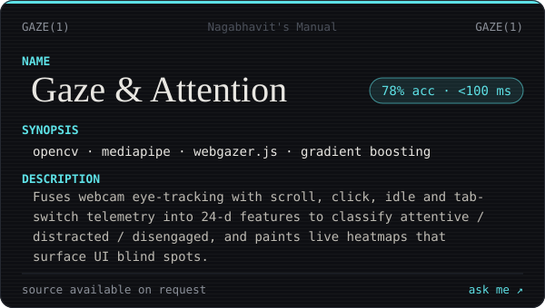</a>
  <a href="https://github.com/nagabhavit/web_scrapper">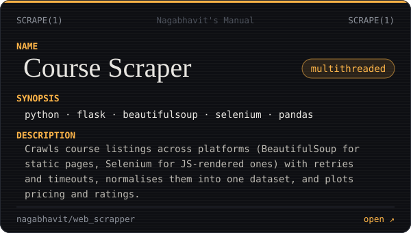</a>
  <a href="https://github.com/nagabhavit/Attendly_-Attendance_Management_project-">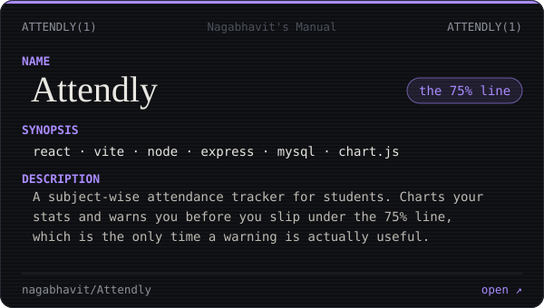</a>
  <a href="https://f1-pitwall-bhavit.netlify.app/">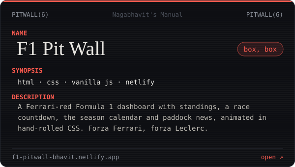</a>
</p>

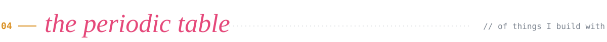


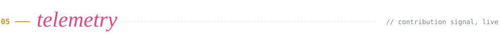




<p align="center"><sub>
  A new card every Monday. The holes are real: the quote's first 80 characters in IBM 029 keypunch code, readable by anyone with a card reader and too much free time.
</sub></p>

<br/>

<a href="mailto:nagabhavit.p@gmail.com"></a>

<!--
  Everything in assets/ is generated:
    python scripts/build_static.py   banner, headers, cards, periodic table, footer
    python scripts/profile_bot.py    punch card + telemetry (also run daily by .github/workflows/profile.yml)
-->
